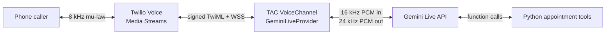

# Twilio Agent Connect + Gemini Live (Python)

A runnable phone-agent demo that connects Twilio Programmable Voice to Gemini Live through
Twilio Agent Connect (TAC). Callers reach a fictional appointment concierge that can check
availability, confirm details, and invoke Python tools during the call.

The root URL is also a live showcase dashboard. It displays call state, streaming transcript,
tool activity, interruptions, and the active voice architecture without a frontend build step.



The provider is deliberately separate from `app.py`, so the same bridge can be reused with
different prompts and tools.

## What the demo covers

- Inbound calls through TAC's signed `/twiml` webhook and `/ws` Media Stream.
- Outbound calls with `python app.py --to +15551234567`.
- Stateful, full-duplex conversion between Twilio's 8 kHz mu-law audio and Gemini's PCM audio.
- Gemini-native input/output transcription and a transcript printed when the call ends.
- Barge-in: a Gemini interruption immediately sends Twilio a `clear` event so buffered speech
  does not continue over the caller.
- TAC `@function_tool` functions exposed as Gemini function declarations.
- A `/health` endpoint for tunnel and deployment checks.
- A live dashboard at `/`, updated through a lightweight Server-Sent Events stream.

## Prerequisites

- Python 3.11–3.14 and [uv](https://docs.astral.sh/uv/).
- A Twilio account, a voice-capable Twilio number, an API key/secret, and an auth token.
- A Gemini API key with access to a Live API model.
- A public HTTPS/WSS tunnel such as ngrok for local development.

## Run it

1. Install and configure the app.

   ```bash
   uv sync
   cp .env.example .env
   ```

   Fill in every Twilio value and `GEMINI_API_KEY`. `TWILIO_VOICE_PUBLIC_DOMAIN` is only the
   public host name, without `https://`, for example `abc123.ngrok.app`.

2. Start a public tunnel in one terminal.

   ```bash
   ngrok http 8000
   ```

3. Start the server in another terminal.

   ```bash
   uv run python app.py
   ```

4. In Twilio Console, open the active phone number and set **A call comes in** to a `POST`
   webhook at:

   ```text
   https://YOUR_PUBLIC_DOMAIN/twiml
   ```

5. Call the number. Try: “I need an oil-change appointment next Tuesday.” The agent should
   check availability, ask for the remaining details, request explicit confirmation, then
   return a clearly labeled demo confirmation.

Open `http://localhost:8000/` to watch the call on the dashboard. The page stays useful after
hang-up by preserving the most recent transcript and tool activity in memory.

For an outbound call, use a destination in E.164 format:

```bash
uv run python app.py --to +15551234567
```

Only call recipients who have consented, and follow the calling and recording laws that apply
to your use case.

## Useful configuration

| Variable | Purpose | Default |
|---|---|---|
| `GEMINI_LIVE_MODEL` | Live API model ID | `gemini-3.8-live` |
| `GEMINI_VOICE_NAME` | Gemini prebuilt voice | `Kore` |
| `TWILIO_VOICE_PUBLIC_DOMAIN` | Tunnel/deployment host | required |
| `TWILIO_SERVER_PORT` | Local HTTP port | `8000` |
| `DEMO_OUTBOUND_TO` | Place one call at startup | unset |

The default model is intentionally environment-configurable because Live model names and
availability evolve. To change the business story, edit `SYSTEM_INSTRUCTION` and the two
`@function_tool` functions in `app.py`.

## Verify locally

```bash
uv run ruff check .
uv run mypy src
uv run pytest
```

The test suite does not contact Twilio or Google. It covers both audio directions, TwiML,
barge-in clearing, transcript assembly, and tool responses.

## Production hardening after the demo

- Keep call affinity or externalize active session state before running multiple app replicas.
- Add structured latency metrics around the Twilio input, first Gemini audio, and tool calls.
- Add reconnect/session-resumption handling for long-lived Gemini sessions.
- Replace the in-memory demo booking with an idempotent backend and authenticated tool layer.
- Add load shedding, call-duration limits, spend alerts, and an explicit human-handoff path.
- Review consent, disclosure, recording, data-retention, and outbound-call requirements with
  counsel before using real customer data.
